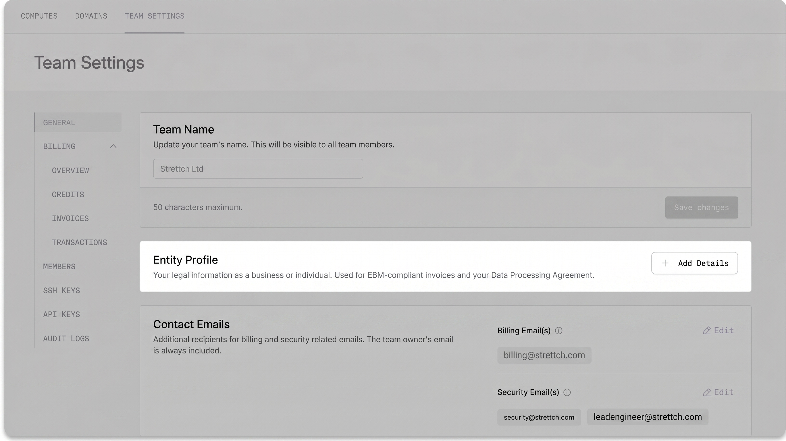
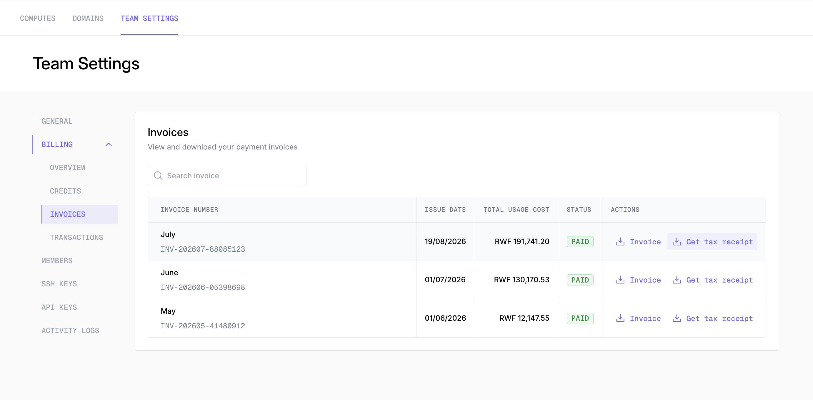

You can generate an official tax receipt for any paid invoice. In Rwanda, the Rwanda Revenue Authority (RRA) requires tax receipts to be issued through its Electronic Billing Machine (EBM) system, and Strettch Cloud issues them through it.

Receipts cover Rwanda only. A receipt is not the same as your monthly [invoice](/faqs/invoices): the invoice is your billing statement, and the receipt is the tax document for an invoice you have paid.

## Before you start: add your entity details

Your Entity Profile holds the legal details that appear on every receipt. An Owner or an Admin adds it once. Go to **Team Settings** > **General**, find the **Entity Profile** section and click **Add Details**.

<Frame>
  
</Frame>

The form asks for a **TIN** and a **Company Name**, which are optional, and for a **Country**, a **Province** and a **Street Address**.

<Tabs>
  <Tab title="Registered Rwandan business (with TIN)">
    Enter your 9-digit TIN. We check it with RRA and fill in **Company Name** and **Province** from the RRA record, so you only add your **Street Address**.

    Only Rwandan TINs are accepted. A TIN that is not 9 digits, or that RRA does not know, is refused.
  </Tab>
  <Tab title="No TIN">
    Leave the **TIN** field empty and fill in **Country**, **Company Name**, **Province** and **Street Address** yourself.

    Without a TIN, your receipts are registered against the phone number of the team Owner.
  </Tab>
</Tabs>

<Warning>
  Check the details before you save. You can change an Entity Profile only twice in six months.
</Warning>

## Generate a receipt

<Steps>
  <Step title="Open your invoices">
    Go to **Team Settings** > **Billing** > **Invoices**.
  </Step>
  <Step title="Choose a paid invoice">
    On an invoice that is **PAID**, click **Receipt**.

    <Frame>
      
    </Frame>
  </Step>
  <Step title="Add your entity details (first time only)">
    If your team has no Entity Profile yet, a dialog asks for it. Click **Add Details** and fill in the form. You are taken back to your invoices.
  </Step>
  <Step title="Enter your purchase code (with a TIN only)">
    If your Entity Profile has a TIN, the dialog asks for a **Purchase Code**. Enter the 6 characters and confirm. See [Purchase codes](#purchase-codes).

    If your Entity Profile has no TIN, you are not asked for a code.
  </Step>
  <Step title="Download the receipt">
    The receipt downloads as a PDF. It is saved, so the next time you click **Receipt** on this invoice it downloads straight away.
  </Step>
</Steps>

## Purchase codes

RRA requires a purchase code to issue a receipt against a TIN. The code has exactly 6 characters, and you get it from RRA. The **How do I get a purchase code** link in the receipt dialog takes you there.

You need a purchase code only when your Entity Profile has a TIN.

## Frequently asked questions

<AccordionGroup>
  <Accordion title="Why is there no Receipt button on an invoice?">
    A receipt is available only for an invoice that is paid. If a paid invoice has no receipt, [contact support](/support).
  </Accordion>
  <Accordion title="Can I get a receipt without a TIN?">
    Yes. The TIN is optional. Without one, you are not asked for a purchase code, and the receipt is registered against the phone number of the team Owner.
  </Accordion>
  <Accordion title="Why is my TIN refused?">
    Only Rwandan TINs are accepted, and a TIN has 9 digits. Check the number. If it is a valid Rwandan TIN and it is still refused, [contact support](/support).
  </Accordion>
  <Accordion title="Who can generate receipts and edit the entity details?">
    Any member of the team can generate and download a receipt. Only an Owner or an Admin can add or edit the Entity Profile.
  </Accordion>
  <Accordion title="Why do I get no receipt when I top up?">
    A top-up adds funds to your team. It is not yet a purchase, so there is nothing to issue a tax receipt for. Receipts are for the services you used, which your monthly invoice adds up. That is why a receipt comes from a paid invoice.
  </Accordion>
</AccordionGroup>
