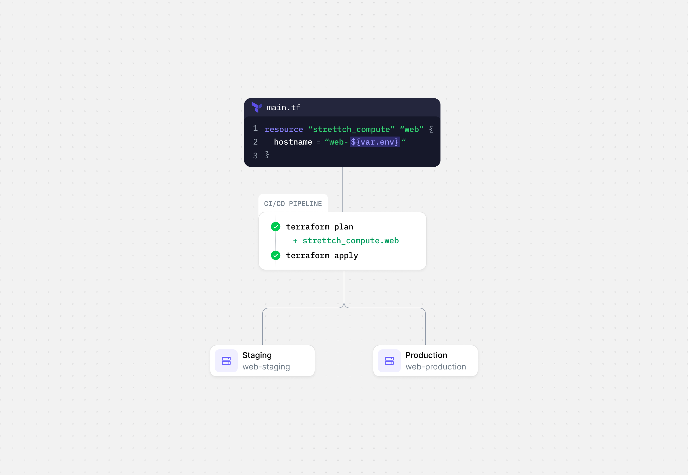

The official [Strettch Cloud Terraform provider](https://registry.terraform.io/providers/strettch-cloud/strettchcloud/latest) lets you create and manage computes from Terraform files. You describe a compute in a file, review the change with `terraform plan`, and apply it.

<CardGroup cols={3}>
  <Card title="Quickstart" icon="rocket" href="/terraform/quickstart">
    Create your first compute with Terraform.
  </Card>
  <Card title="Terraform Registry" icon="book-open" href="https://registry.terraform.io/providers/strettch-cloud/strettchcloud/latest/docs">
    Every resource, data source and argument.
  </Card>
  <Card title="Source on GitHub" icon="github" href="https://github.com/strettch-cloud/terraform-provider-strettchcloud">
    Read the code and open issues.
  </Card>
</CardGroup>

<Frame>
  
</Frame>

## What you can manage

- **Computes** (`strettchcloud_compute`): create, update, upsize, reboot and destroy.
- **Images, regions and specifications**: look them up as data sources, so your files do not depend on a slug that can change.

[Resources and data sources](/terraform/resources) lists each one.

## Add the provider

```hcl
terraform {
  required_providers {
    strettchcloud = {
      source  = "strettch-cloud/strettchcloud"
      version = "~> 1.0"
    }
  }
}

provider "strettchcloud" {
  # api_key is read from the STRETTCH_CLOUD_API_KEY environment variable.
}
```

Keep your API key out of your Terraform files. Set it in the `STRETTCH_CLOUD_API_KEY` environment variable. See [Authentication](/terraform/authentication).

## Provider settings

Every argument is optional. You can set each one in the provider block or with the environment variable next to it.

| Argument | Type | Default | Environment variable | What it sets |
| --- | --- | --- | --- | --- |
| `api_key` | string | none | `STRETTCH_CLOUD_API_KEY` | Your API key. The provider needs one, from this argument or from the environment variable. |
| `api_url` | string | `https://api.strettch.cloud/api/v1` | `STRETTCH_CLOUD_API_URL` | Base URL of the Strettch Cloud API. |
| `requests_per_second` | number | `2` | `STRETTCH_CLOUD_REQUESTS_PER_SECOND` | How many requests a second the provider sends. A higher value is capped at `2`, the [API rate limit](/api-reference/introduction#rate-limit). |
| `http_retry_max` | number | `4` | `STRETTCH_CLOUD_HTTP_RETRY_MAX` | How many times the provider retries a request that can be retried, after the first attempt. |
| `http_retry_wait_min` | number, seconds | `1` | `STRETTCH_CLOUD_HTTP_RETRY_WAIT_MIN` | The wait before the first retry. |
| `http_retry_wait_max` | number, seconds | `30` | `STRETTCH_CLOUD_HTTP_RETRY_WAIT_MAX` | The longest wait between two retries. |
